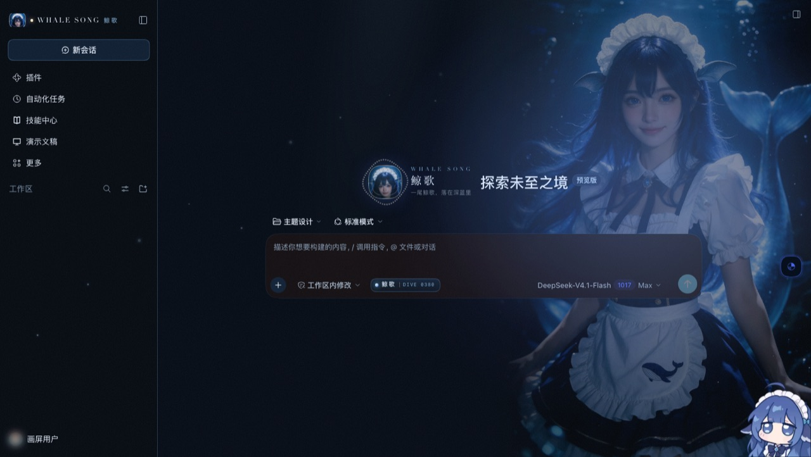
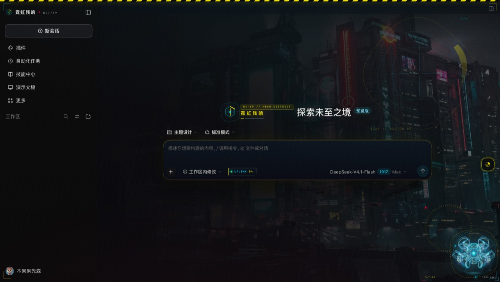
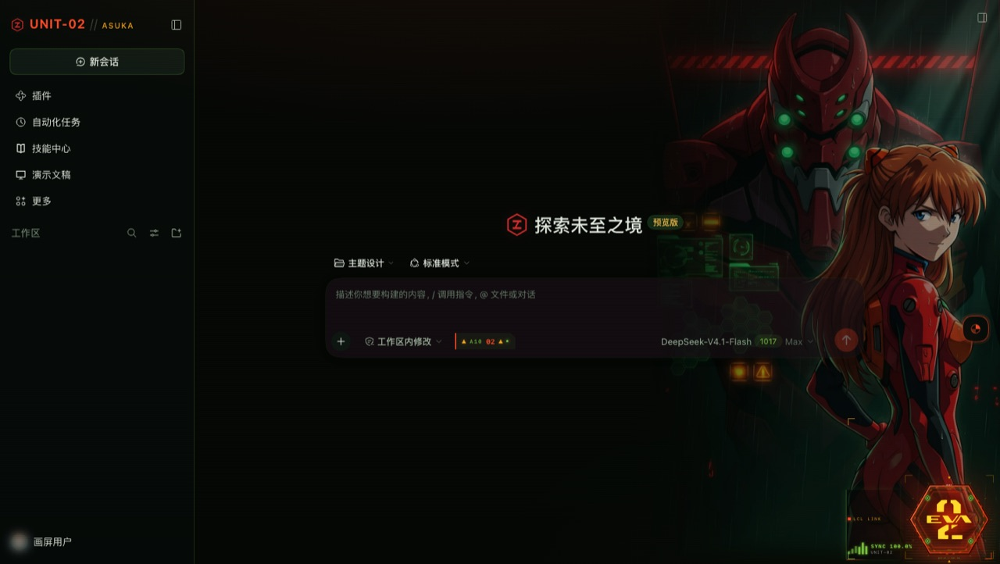
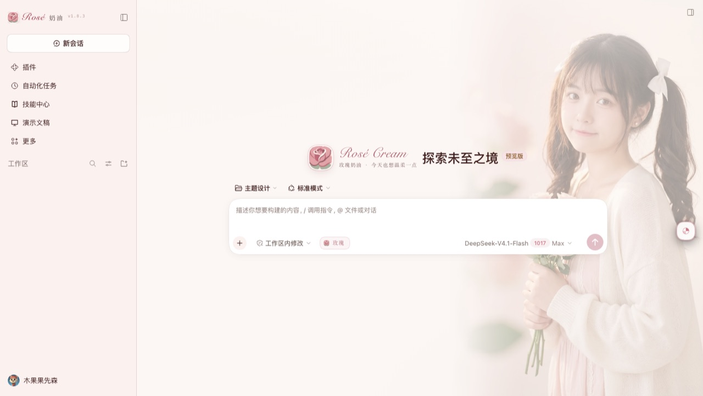

# 画屏 · PAINTED SCREENS

`@mhstory/huaping`

> 一个插件，多套皮肤。悬浮切换器即时换肤，选择会被记住。

DSH Web UI 的多皮肤包。一个插件行、一个版本号、一个仓库——里面是可切换的皮肤。

| 皮肤 | 气质 | 支持 | 状态 |
|---|---|---|---|
| **黑金回廊** · NOIR ARCADE | 哥特夜景 · 穹顶彩窗与烛光 | 深色 | ✅ 已实现 |
| **墨竹** · INK BAMBOO | 纸窗竹影，一片叶子偶尔落下 | 浅色 | ✅ 已实现 |
| **绯夜尤物** · VELVET SIN | 装饰艺术 · 绯红霓虹与旧金细线 | 深色 | ✅ 已实现 |
| **玫瑰奶油** · ROSÉ CREAM | 柔粉写真 · 奶油高光与玫瑰 | 浅色 | ✅ 已实现 |
| **霓虹残响** · NEON AFTERIMAGE | 夜城霓虹 · 黄黑警戒与全息扫描 | 深色 | ✅ 已实现 |
| **EVA-02** · ASUKA | 驾驶舱 HUD · 橙红警报与同步率 | 深色 | ✅ 已实现 · **非官方同人（禁止商用分发）** |
| **青冥 · 剑冢** · QINGMING | 雪夜剑气 · 宣纸留白与朱砂印 | 深色 | ✅ 已实现 |
| **曜界** · AURELIS | 轨道机库 · 象牙白装甲与光晕 | 深色 | ✅ 已实现 |
| **鲸歌** · WHALE SONG | 深海女仆 · 鲸鳍耳与蕾丝围裙 | 深色 | ✅ 已实现 |
| **大肥鱼** · BIG FAT FISH | 深海鲸娘 · 孤冷蓝调与鲸尾夜航 | 深色 | ✅ 已实现 · 同人 |
| **一比特** · 1-BIT SYSTEM | 黑白两色 · 4×4 网点与 640K 自检 | 浅色 | ✅ 已实现 |
| **废土电台** · RUST RELAY | 废土科幻 · 沙尘、锈迹与信号条 | 浅色 | ✅ 已实现（托管） |
| **零点以后** · AFTER ZERO | 夜班女仆长 · 黄铜怀表与丝绒 | 深色 | ✅ 已实现 |
| **午后三时** · TEA AT THREE | 试用期女仆 · 薄荷奶油与草莓塔 | 浅色 | ✅ 已实现 |
| **猫在窗台** · WINDOW CAT | 橘猫 · 毛线球与午后太阳 | 浅色 | ✅ 已实现 |

---

## 皮肤预览

| 樱花树下 | 鲸歌 |
|---|---|
|  |  |

| 霓虹残响 | EVA-02 |
|---|---|
|  |  |

| 玫瑰奶油 | 墨竹 |
|---|---|
|  |  |


## 预览

`preview/index.html` 用**真实的 `client.js`** 加一个 40 行的迷你 React，在浏览器里跑起一个仿真外壳——不安装、不碰 DSH profile：

```bash
open preview/index.html?skin=noir-arcade
open preview/index.html?skin=ink-bamboo
open preview/index.html?skin=velvet-sin
open preview/index.html?skin=whale-song
open preview/index.html?skin=whale-song&boot=1   # 下潜开场
open preview/index.html?skin=big-fat-fish
open preview/index.html?skin=big-fat-fish&boot=1    # 蓝鲸下潜开场
open preview/index.html?panel=1                    # 切换器展开
```

| 黑金回廊 | 墨竹 |
|---|---|
|  |  |

| 绯夜尤物 | 切换器 |
|---|---|
|  |  |

| 鲸歌 · WHALE SONG | 下潜开场 |
|---|---|
|  |  |

| 大肥鱼 · BIG FAT FISH | 启动幕 |
|---|---|
|  |  |

## 鲸歌 · WHALE SONG

把 DeepSeek 那头蓝鲸画成一个真人：蓝发、鲸鳍耳、白蕾丝头饰、深蓝女仆裙配金色滚边，
围裙上绣着一头小鲸，身后拖着一条半透明的鲸尾，整个人泡在深海的蓝里。
名字取「鲸歌」——深海里的一首歌，比「蓝鲸小姐」轻，也更像这片蓝本身。

- **110 个 token** 全落在海沟蓝上：`#040A13` 的海底、`#4D6BFE` 的 DeepSeek 蓝、`#7FE0FF` 的水光、`#EAF6FF` 的珍珠，再借一点女仆裙的旧金做极细的线。
- **写真层在内容之下**：照片走 `body` 的 `background-image`，左侧 30% 宽度 alpha 羽化进黑暗。壁纸按 `auto 106vh` 贴右缘竖放，脸落在标题区上方、裙摆垂到输入框底下；会话面板只留 2% 底色，靠正文的极淡投影和她的深蓝把字托住。
- **纹章是她的脸**：从写真里裁一枚圆形头像，外面套一圈珍珠点环 + 一道内圈金线，对应头饰的蕾丝与裙边滚边；28px 侧栏标另用一张提过亮、给头饰留足余量的裁切，圆框不会切掉头顶。
- **下潜开场**：鲸鱼从水面沉下来，深度尺从 0 走到 3800 m；`sessionStorage` 每会话一次，点任意处跳过。
- **气氛只做加法**：光柱、上浮的气泡、颗粒噪点都走 `screen` / `overlay` 混合，只加光、不压暗。
- **输入区**：「鲸歌 · DIVE 0380」胶囊 + 底部声呐刻度条（`conversation.composer.dock`）；首屏那句副题是「一尾鲸歌，落在深蓝里」。

> **一比特的封面**：不是启动幕截图，是一张手绘的 1-bit 像素图（780×320，按皮肤库卡片的裁切比例构图）——机身、鼠标、屏里的抖动柱状图、`1984 ──► 2026` 都是在构建脚本里逐像素画出来的。

> **一比特的挂件**：右下角那台小鲸鱼换成了一台 1984 的 Mac（`art/widgets/1bit-mac/art.svg`，纯黑白手绘 SVG，投影用网点而不是模糊）。它说话时，挂件自带的云朵气泡会被 `runtime.js` 改写路径成一块**直角面板**：白底、2px 黑边、4px 硬投影、左上角钉一枚 `1-BIT` 标签；面板里原本的彩虹字（`dshwv-rgb`）、彩虹色块（`dshwv-bgrgb`）和挂件面板里配的行内颜色，全部压回黑白。Mac 压在这块面板的右下角，让它看起来像「说话的那位」。

> **写真怎么来的**：`art/skins/whale-song/assets/visual.webp` 按原图 1664×2496 出（早期缩到 1000×1500，2 倍屏按 106vh 铺开要 1900+ 设备像素，脸就糊了），构建时内联进 `client.js`，皮肤包不发额外图片请求。
> 这一版用 Flux Art OpenAPI 出图：同批跑了 `doubao-seedream-5-0-pro-260628`（2K，240 点）、`gpt-image-2`（2K，60 点）和 `gemini-3-pro-image-preview`（2K，160 点），海底版与咖啡厅版各一张；最后按「人物最美 + 鲸的身份最全」选了 Seedream 这张。
> 换图：原图放 `art/source/whale-song-visual.jpg`，跑 `python3 tools/make-visual.py && node tools/build.mjs`——羽化宽度、调色在脚本里，取景在 CSS 里。

## 大肥鱼 · BIG FAT FISH

把 DeepSeek 的蓝鲸画成二次元鲸鱼娘：蓝发蓝瞳、鲸鳍耳、白色褶边女仆头饰、
深蓝长裙与白围裙，围裙上绣着一只小鲸，身后拖着一条大鲸尾——成熟、高挑、曲线分明；
鲸鳍耳、呆毛圈、领口蝴蝶结都按参考图保留，耳朵再用四次局部 edit 削尖、收小、改成向下耷拉的小鲸鳍、再收小一档；人物整体再右移 60px 贴边。半垂着眼、微微抬着下巴，带着桀骜不驯的孤冷；
她贴着画面右缘，身后是冰蓝的晶体与冷光。

- **110 个 token**：深海夜航的靛蓝 `#020913`、DeepSeek 蓝 `#4D6BFE`、水光青 `#7FE7FF`、奶油 `#FFF4DF`、珊瑚 `#FF9FB2`、金边 `#E8C27E`；深色主题，light/dark 同值。
- **主视觉是生成的**：Flux Art `gemini-3-pro-image-preview`（Nano Banana Pro）2K、16:9 冷调直出；角色本来就站在右缘，右侧肩膀/裙摆略微出画，左侧是冷色深水与冰蓝晶体，不再做二次合成。
- **右缘留人，左侧留字**：1440 × 900 下鲸鱼娘贴着右缘，冷光只打在她身上，左侧正文列压在暗水区；半垂眼、微抬下巴的表情在启动幕里最完整。
- **角色一致性**：侧栏 28px、首屏 54px、启动幕 68px 与输入框 19px 的头像，都来自主视觉同一张脸部裁切；dock 里保留一只小鲸鱼，呼应 DeepSeek 的蓝鲸。
- **hero 玻璃牌**：`大肥鱼 / BIG FAT FISH / DEEPSEEK · WHALE GIRL`，压在鲸鱼娘身上时用深色玻璃保证可读。
- **启动幕**：2s，鲸鱼娘头像 + `大肥鱼` + `BIG FAT FISH` + 进度条 + `深海很冷，正合我意。`；点击/按键跳过，`?boot=1` 重播、`?boot=0` 跳过，`prefers-reduced-motion` 缩短。
- **输入区**：`大肥鱼 · 深潜` chip + 鲸鱼小标 + `DIVE −1,024 m` 深度尺（`conversation.composer.dock`）。
- **资源**：`keyvisual.webp`（约 252 KB）与 `face.webp`（约 49 KB）构建时内联进 `client.js`，皮肤不额外发图片请求。
- **参考与版权**：角色设定参考用户提供的鲸鱼娘设定图——原图：字母AI《DeepSeek 里长出了个“鲸鱼娘”》，36氪，2026-08-20；角色原型：上善无形；女仆二创：ZipZipPipe；标注：言辞之间；冷调表情参考用户提供的第二张特写（签名 Cat）。画面为本次 Flux Art 新生成的原创演绎，不复用原图，不使用 DeepSeek 官方素材或官方标识。
- **生成说明**：`FLUX_ART_API_KEY` 只从环境变量读，不写盘；回执只留 task id、模型、用量与输出 URL。复现命令见 [art/big-fat-fish/README.md](art/big-fat-fish/README.md)。

> 皮肤免费分享，不接赞助；同人向原创演绎，请勿误认为官方。

## 樱花树下 · UNDER THE SAKURA

黄昏的樱并木：两排樱树一路收到远山，太阳压在地平线上，花瓣一直在落。**画面是实时三维的**——不是贴图，也不是预渲染的视频。

- **场景来自设计稿**：`sakura-5cm.html` 里那套 Three.js 程序化场景（天空 shader / 远山 / 樱树 / GPU 实例化落樱 / 草与地面花瓣）原样搬进来；去掉了原稿的铁轨、枕木、电车、电线杆——那些是「五厘米」的故事道具，也去掉了标题、日文题记和右上角提示，皮肤只留画面。
- **不连 CDN**：`art/skins/sakura/vendor/three.min.js` 由 `tools/build.mjs` 灌进 `hosted.js` 的 `/*__THREE_SRC__*/` 占位符，构建后仍是单个 `client.js`，断网可用。
- **压在最底下**：一张 `position: fixed; z-index: -2` 的 canvas，上面一层 `.sk-scrim` 管压暗，应用自己的表面才铺在它们之上。
- **遮罩从左往右退**：`linear-gradient(100deg, …)` 在正文列这一侧压到 0.9，到右缘收到 0，字有底、树也留得下。侧栏在宿主里是写死的 `rgb(27,27,27)`，改成 `--dsw-specific-sidebar-fill` 的半透明值，不然会是一块堵死的黑板。
- **强调色只有一个**：深樱粉 `#FF1F7A`。选中行、新会话按钮、链接、开关、文档选区全部收到它身上；`#F58FB0` 那种淡粉压不住深色背景。
- **标志是一整朵樱花**：五瓣绕花心，但角度、瓣宽、大小都带 ±5° / ±8% 的手绘偏差——完全等分的五瓣会像图钉；颜色走浅粉（`#FFAACB → #FFECF4`），压在深底上不刺眼。画屏列表的封面用的是同一朵（`art/logo-sakura.svg`，由 `tools/make-cover.mjs` 贴上去）。
- **右下角挂件是一个女孩子的背影**：余额小鲸鱼被替换成她（`art/widgets/sakura/`）——长发、深色大衣、单肩包，侧逆光打在肩线和发梢上，站在画面右下角朝落日看；6.5s 一次呼吸，抠白底后内联进 `client.js`。原图 `art/gen/sakura-widget-girl.jpg`，`doubao-seedream-5-0-pro-260628` 2K 3:4 生成，登记见 NOTICE。
- **她说的话是一只暮色气泡**：挂件原生气泡是「白云 + 深蓝粗描边 + 蓝字」，这里换成 `rgba(26,15,23,.93)` 的玻璃底 + 7px 樱粉细边，余额数字改用衬线、提示行用等宽，右上角钉一朵小樱花做落款；配套的鲸鱼 gif 藏掉。每轮消耗那套自定义行里的彩虹色块（`dshwv-bgrgb-*`）统一收成樱粉，白描边去掉——那是给白底准备的，压在深色玻璃上会显脏。
- **机位**：`camera (0, 3.0, 8.0)`、视线抬到 `y = 5.2`，地平线落在窗口 55%——上半屏是树与天光，下半屏留给输入框和正文。
- **省电**：首帧后帧率低于 36 就把 pixelRatio 降到 1；`prefers-reduced-motion` 不挂场景，退回一层黄昏渐变。

> 皮肤免费分享，不接赞助；同人向原创演绎，请勿误认为官方。

---

## 零点以后 · AFTER ZERO

女仆三部曲的第一部：夜班女仆长。近黑酒红 + 黄铜细线 + 一支烛的光。

- **壁纸**：用户提供的人物主视觉，左侧留黑给正文；`tools/compose-zero-wall.py` 在它上面叠了四团朦胧光和一层 bloom（把亮部模糊 28px 回叠 42%），再补几粒环境微光——左侧最暗，保证正文可读。
- **画布** 3246×1745（约 1.86），宽屏下 `cover` 只裁左边的空暗部，**底部永远不裁**。
- **挂件**：她手里那只黄铜怀表，`art/widgets/after-zero/watch.svg` 手写 SVG（表盘写 `No.07`），6s 明暗呼吸；气泡是酒红丝绒信笺 + 黄铜细线 + 右下角 `07` 火漆印。
- **品牌标记**：侧栏与英雄位都是怀表线描（`components.js` 的 `WatchMark`）。
- **封面**：`tools/make-cover-zero.py`，左栏（怀表 logo + 标题 + 拉丁 + 说明）用 `getbbox()` 量高后自动垂直居中。

## 午后三时 · TEA AT THREE

女仆三部曲的第二部：试用期见习女仆。奶油底 + 薄荷 + 草莓。

- **抠图**：`tools/cutout-white.py` 用「边缘泛洪 + 梯度护栏」从白底里抠人——遇到边缘就停，所以白围裙不会被吃穿。
- **壁纸**：`tools/compose-tea-wall.py` 把抠图放进奶油房间（薄荷光 / 草莓光 / 底部格子布 / 柔光点），同样 1.86 宽幅避免裁底。
- **挂件**：她已经在壁纸里，插件换成托盘上的那只**茶壶**（`art/widgets/tea-time/pot.svg`），气泡是奶白便签 + 草莓虚线边 + 薄荷胶带。
- **品牌标记**：拟物茶杯（瓷胎渐变 / 茶汤 / 碟子投影 / 热气）。
- **启动幕**：`art/gen/tea-time-boot.jpg`，由茶壶 + 格子布 + 标题合成。

## 非官方同人声明

**EVA-02 · ASUKA** 是《新世纪福音战士》的**非官方同人作品**：角色、组织名（NERV）、机体编号（EVA-02）
及其设定的版权归 **khara / GAINAX** 所有，本项目与权利人无任何关联。

- 仅供**个人学习与非商业展示**；
- **不得**用于任何收费、商业发行、广告或引流；
- 收到权利人异议将立即下架该主题。

其余主题（除已删除的「红白机」系列）均为原创设计。

## 后续主题的导入方式

导入的方式：在 vm 里跑原主题拿到求值 CSS 和 110 个 token pair，再按**只认工厂层（4 空格缩进）**的规则切出 slot 组件和依赖闭包，生成 `art/skins/<id>/`。

除了 slot 组件，主题还可能有**副作用安装器**（`sidecars`）——比如墨竹的 `installLiveBamboo` 把动画竹影挂到 `<body>`、绯夜尤物的鲸鱼皮肤。导入时一并带出来，激活皮肤时按顺序执行、切走时执行它们的清理函数。

```bash
node tools/import-one.mjs rose-cream   # 单主题导入
```

八套已全部接入，每套都带自己的启动幕、挂件皮肤和皮肤库封面截图。

> **IP 状态**
> - **青冥 · 剑冢**：原主题的著作权名称与专有设定词已全部替换为原创词，包 id 改为 `qingming`。
> - **曜界**：原主题名里的机甲作品字样与英文标识已移除，包 id 改为 `aurelis`。
> - **EVA-02**：保留同人形态。权利方有公开的同人创作指引（非商用、不得使人误认为官方、官方素材只作引用），本项目免费分享、不接赞助，符合其精神；README 不写「官方标识」，仓库图标与仓库名也不使用其商标。

## 架构

```
apply(ctx)
├── activate(skin)                 ← 切换时先 dispose 旧的，再装新的
│   ├── ctx.theme.overrideTokens()  110 个 token，light/dark 同值
│   ├── <style>                     该皮肤的 CSS，切换即换
│   └── data-hp-skin="…"            根属性，便于 CSS 作用域
├── skinStore.subscribe(activate)  ← 切换的唯一入口
└── 7 个 slot 注册（常驻，不随切换重建）
    ├── shell.overlay ×2           皮肤 overlay + 切换器
    ├── sidebar.brand.mark / .name
    ├── conversation.hero.brand.mark
    ├── conversation.input.left
    └── conversation.composer.dock
```

关键点：**slot 只注册一次**。每个 slot 是一个「宿主组件」，它从 store 读当前皮肤，渲染对应组件，切肤时把 `key` 换掉从而重挂载。这样避免了反复注册 slot 带来的泄漏和顺序问题。

---

## 怎么切换皮肤

插件启用后，界面右缘中部会出现一个圆形按钮（画屏的分色圆标）：

1. 点它 → 打开**整页皮肤库**：顶部有搜索框与标签筛选（复古 / 单色 / 国风 / 机甲 / 哥特 / 装饰艺术 / 赛博 / 柔粉 / 深色 / 浅色 / 同人 / 原创 / 壁纸 / 动画），卡片按题材分组排序并各自带标签；每张封面是**同一构图规则**的真机启动幕截图（16:9、满幅、720×405），一眼能看出该主题的标题样式与主视觉；搜索框与标签栏**固定不滚动**，卡片每页 6 张、滚到底自动续页（也可点「加载更多」），封面图 `loading="lazy"`；每张卡片显示**该主题的启动幕**（不是截图，是同一套组件实时渲染的静态帧），下面是名字、拉丁名和一句话描述，当前皮肤标「● 已应用」；按钮可以**按住拖动**到任意位置（指针捕获，移出按钮后仍跟手），位置记在 `localStorage['huaping-anchor']`；按钮与面板的颜色**跟随当前皮肤**——取该皮肤的 `brand-primary` / `label-primary` / 底色，通过 `--hp-accent` / `--hp-ink` / `--hp-surface` 注入；
2. 点任意一张 → **立即生效**，不用刷新、不用重启，面板保持打开，可以直接来回对比；
3. `Esc`、点遮罩、或右上角 `×` 关闭。

选择存在 `localStorage['huaping-skin']`，刷新和重启后保持。

> 为什么不是「设置里的一个下拉」：DSH 的设置导航是 `settings.section` 账本，插件确实可以往那里注册页面，但那是二阶入口——用户要先开设置、再找分区。换皮肤是**高频、看效果**的动作，应该在画面上直接可及。设置入口作为补充入口有价值，见下方路线图。


## 安装与切换

```bash
# 本地目录
dsh plugin --profile desktop add /path/to/huaping

# GitHub
dsh plugin --profile desktop add github:mhstory/huaping
```

启用后在「设置 → 插件」里打开这一行即可，**不需要重启**。

切换皮肤：左下角有一个圆形的画屏按钮 → 点开皮肤网格 → 点选。选择写在 `localStorage['huaping-skin']`，刷新后保持。

---

## 目录

```
huaping/
├── client.js                ← 构建产物（DSH 实际加载这个）
├── src/client.template.js   ← 可读源码，改这个
├── art/
│   ├── palettes.json        每套皮肤一份 110 键调色板
│   ├── token-map.json       --dsw-alias-* ↔ 调色板键
│   ├── source/              出图原图（whale-song-visual.jpg 1664×2496）
│   └── （主题资源由 import-one 生成到 art/skins/）
├── skins/<id>/skin.json     皮肤元数据
├── tools/
│   ├── build.mjs            注入调色板/token 表/画作 → client.js
│   ├── make-visual.py       原图 → 羽化 webp（鲸歌壁纸）
│   └── verify-runtime.mjs   无头运行时验证
├── index.js / cordis.patch.yml / locale/ / icon.svg
└── LICENSE
```

### 构建

```bash
node tools/build.mjs          # src/client.template.js + art/ → client.js
node tools/build.mjs --check  # CI: client.js 是否落后于源码
node tools/verify-runtime.mjs # 运行时契约验证
```

`verify-runtime.mjs` 会用桩宿主 + 40 行 React shim 真的跑一遍：冷启动 → 点开切换器 → 切换皮肤 → 卸载 → 重载恢复 → 未知皮肤回退。断言包括 token 数、样式替换、旧层是否被 dispose、根属性、持久化。

皮肤目录里的 `extra.css`（如果有）会拼在 `skin.css` 后面一起内联进 `client.js`——用来整段推翻背景或面板，不必把实验值写回主样式。它是「后手」，靠顺序和 `!important` 生效。

---

## 加一套皮肤

1. 在 `art/palettes.json` 里加一份 110 键调色板（照任意一套抄结构）；
2. 在 `skins/<id>/skin.json` 写元数据；
3. 在 `src/client.template.js` 里加一个对象：

```js
{
  id: 'my-skin',
  name: '我的皮肤',
  latin: 'MY SKIN',
  blurb: '一句话',
  appearance: 'dark',
  palette: 'my-skin',
  swatch: ['#000', '#111', '#222', '#333'],
  css: MY_CSS,
  Overlay, SidebarMark, BrandName, HeroMark, InputLeft, ComposerDock,
}
```

4. `node tools/build.mjs && node tools/verify-runtime.mjs`。

不用改运行时，不用碰 slot 注册。

---

## 已验证 / 未验证

**已用截图验证**（1440×900，仿真外壳）

- 四套皮肤的调色板、纹章、输入区、字标都成立（三深一浅、两套带画作、两套纯矢量）
- 线路图收在右下 L 形，正文列不被压
- 切换器在左下角、展开面板、当前皮肤高亮
- 第一轮截图暴露并修掉了两个问题：线路图铺到正文区、切换按钮压住侧栏页脚

**真机验证**（DSH 0.1.1-rc.2，desktop profile，三套逐项过）

- 装上后两套深色皮肤与一套浅色皮肤都正常渲染，token 无漏色
- 点「墨竹」实时切到浅色：宿主 `data-ds-dark-theme` 被摘掉，`body` 背景变成 `rgb(242,236,220)`
- 三套启动幕、三套挂件皮肤都是原版实现，逐套在真机上确认过；切换时上一套的类名/角色图/HUD 会被清干净
- 切换器面板在真机上可开、三张卡片、当前项高亮
- 真机暴露过两个预览发现不了的问题，都已修：
  - **单例 slot 冲突**：`sidebar.brand.mark` / `.name` / `conversation.hero.brand.mark` 是单例，已有别的注册占着 -1，撞车会让 `apply` 直接抛错、后续 slot 全部不注册。改成 `priority: -100`（数字更低者渲染）。
  - **切换器挡住侧栏会话列表**：原来固定在左下角，压在会话项上。改到右缘中部，并提高了对比度。

**运行时契约已验证**（`node tools/verify-runtime.mjs`，35 项断言全过）

- 110 个 token 全部覆盖，light/dark 同值，不会在宿主切深浅色时露色
- 冷启动、切换、切回、卸载时样式与 token 层都被正确替换/释放
- 切换器组件真实渲染，卡片点击触发切换并持久化
- 重载后恢复上次皮肤；未知 id 回退到默认
- 全屏层 `pointer-events: none`，且 z-index 与官方主题一致（`2147482000`），不会拦截点击

**未验证**（需要真机）

- `conversation.composer.dock` 在 DSH 0.1.1-rc.2 里没有渲染出来（组件已注册，但宿主没挂这个 slot），所以「站台边缘 / EVENSONG」那条装饰在真机上看不到。保留注册以便宿主未来版本出现该 slot。
- 1440×900 以外的尺寸（宽屏、手机）未在真机上验证。

---

## 路线图

- **设置页入口**：`settings.section` 是设置导航的账本，插件可以注册自己的分区页面；`settings.general.item` 可以在「通用」里加一行。做法已摸清（`ctx.slots.register({ name, id, order }, Component)`），等有空验证 `settings.section` 的选项契约后补一个「外观 · 画屏」分区，作为皮肤库的第二个入口。
- **更多皮肤**：`tools/import-one.mjs` 加一条配置即可接入新主题（色板、CSS、slot 组件、启动幕、挂件皮肤一起导入）。
- **启动幕**：一次性开场还没进运行时。

## 已知取舍

| 项 | 现状 | 备选 |
|---|---|---|
| 包体积 | 4 套 174 KB（含两张内联画作，另两套纯矢量） | 8 套预计 250–300 KB；超了再按皮肤拆 |
| 切换器位置 | 固定左下角（`left/bottom: 16px`） | 若与侧栏底部控件打架，改 `.hp-switch` 的 `left/bottom` |
| 挂件皮肤 | 尚未接入 | 下一步：`dsh-whale-widget` 的 `dshwv-*` 皮肤并入同一套切换 |
| 启动幕 | 尚未接入 | 下一步：把各主题的一次性开场收进 `skin.boot()` |

---

## 版权

代码 MIT。两套皮肤的调色板、矢量与画作均为本仓库原创；未使用任何真实城市线路图、地铁运营方标识或第三方素材。

- 「黑金回廊」的穹顶彩窗为原创 SVG，不指向任何真实建筑。
- 「鲸歌」的鲸鱼纹章是手写 SVG；写真为 AI 生成的原创人像，造型参考自社区「鲸鱼娘」二创，不指向任何真实人物，也不使用 DeepSeek 商标或官方标识。

联系方式：开 issue。

## 托管模式（新一代 API 主题）

托管主题这三套用的是新版主题接口（`ctx.theme.register({ id, colorScheme, tokens })`），
组件按变体注册、没有可切片的独立 CSS。对这类主题，画屏不再切源码，而是**在激活时运行原插件**：

1. 构建时把原 `client.js` 原样嵌入（`meta.hosted: true`，源码存在 `art/skins/<id>/hosted.js`）
2. 激活时用一个 shim ctx 执行它的 `apply()`：`theme.register` 记录变体、`slots.register` 收集组件、`effect` 收集清理函数
3. 插槽宿主优先渲染这些运行时组件（`shell.overlay` 里的 Boot 组件单独给启动幕）
4. 切走时按收集到的清理函数回滚

好处是零改造、和原插件行为一致；代价是这几套的源码会进包体（三套合计约 90KB）。

## 生成素材与启动幕

三套托管皮肤（托管主题）的纹理、火漆印、撕边和启动幕底图由 Flux Art 的图像模型生成：

```bash
FLUX_API_KEY=... node tools/gen-art.mjs boot     # 三张启动幕底图
FLUX_API_KEY=... node tools/gen-art.mjs rust     # 锈蚀钢板
```

没有原版启动幕的皮肤，由运行时用 `art/gen/<id>-boot.jpg` 渲染一张通用启动幕（1.7 秒后自动退场）：
底图淡入 0.32s，居中主题名 + 拉丁副题 + 进度线。
