# 画屏 · PAINTED SCREENS

[](LICENSE)
[](#皮肤一览)
[](#安装)

**给 DSH Web UI 的一套皮肤。** 装一个插件，界面里就能换：今天想看清爽的白，明天想陷进深海，都不用改配置。

---

## 为什么是这套

DSH 的界面默认只有一个样子：干净、准确，用久了会有点腻。

画屏给它准备了一批别的样子。水墨的、夜城的、驾驶舱的、深海的、樱花的——装一个插件，屏幕右缘多一个小圆点，点开是一面墙的皮肤，点哪套就变哪套，不用重启，刷新之后还是它。

不是换个配色那么简单。每套皮肤连细节一起换：侧栏的标志、输入框的形状、按钮的质感，还有打开软件那一下——鲸歌是往下潜，樱花树下是花瓣慢慢落，黑金回廊是烛火亮起来。

连右下角那个助手挂件，也会跟着换一套衣服。

装一次，用很久。

## 安装

```bash
# GitHub
dsh plugin --profile desktop add github:meihaoyangfang/painted-screens

# 或本地目录
dsh plugin --profile desktop add /path/to/painted-screens
```

装好后在 **设置 → 插件** 里打开「画屏」，**不需要重启**。

切换：屏幕右缘的圆形按钮 → 点开皮肤网格 → 选一套。可以拖到别处，位置会记住。选择存在 `localStorage['painted-screens:skin']`。

---

## 皮肤一览

已经做好的部分，还在继续加。

| 皮肤 | 气质 | 明暗 |
|---|---|---|
| **樱花树下** · UNDER THE SAKURA | 春日慢速 · 花瓣徐徐落下 | 深色 |
| **鲸歌** · WHALE SONG | 深海女仆 · 鲸鳍耳与蕾丝围裙 | 深色 |
| **霓虹残响** · NEON AFTERIMAGE | 夜城霓虹 · 黄黑警戒与全息扫描 | 深色 |
| **EVA-02** · ASUKA | 驾驶舱 HUD · 橙红警报与同步率 | 深色 |
| **玫瑰奶油** · ROSÉ CREAM | 柔粉写真 · 奶油高光与玫瑰 | 浅色 |
| **墨竹** · INK BAMBOO | 纸窗竹影 · 一片叶子偶尔落下 | 浅色 |
| **黑金回廊** · NOIR ARCADE | 哥特夜景 · 穹顶彩窗与烛光 | 深色 |
| **曜界** · AURELIS | 轨道机库 · 象牙白装甲与光晕 | 深色 |
| **青冥 · 剑冢** · QINGMING | 雪夜剑气 · 宣纸留白与朱砂印 | 深色 |
| **绯夜尤物** · VELVET SIN | 装饰艺术 · 绯红霓虹与旧金细线 | 深色 |
| **大肥鱼** · BIG FAT FISH | 深海鲸娘 · 孤冷蓝调与鲸尾夜航 | 深色 |
| **零点以后** · AFTER ZERO | 暗室与怀表 · 午夜钟声 | 深色 |
| **午后三时** · TEA AT THREE | 午后红茶 · 蕾丝与暖阳 | 浅色 |
| **春野** · SPRING MEADOW | 草甸与远山 · 明亮通透 | 浅色 |
| **一比特** · 1-BIT SYSTEM | 单色点阵 · 复古显示器 | 单色 |

---

## 看看长什么样

| 樱花树下 | 鲸歌 |
|---|---|
| 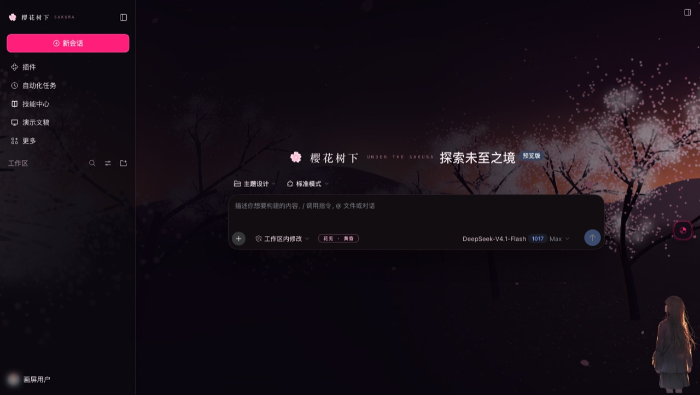 |  |

| 霓虹残响 | EVA-02 |
|---|---|
| 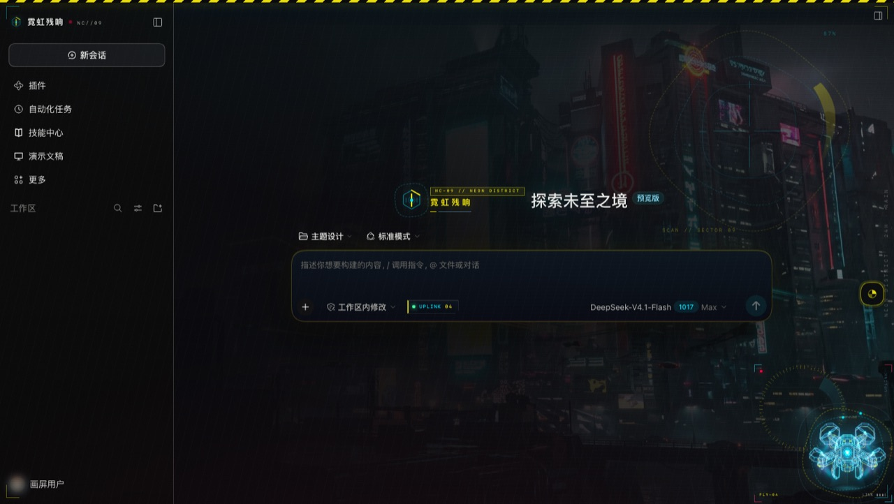 |  |

| 墨竹 | 玫瑰奶油 |
|---|---|
| 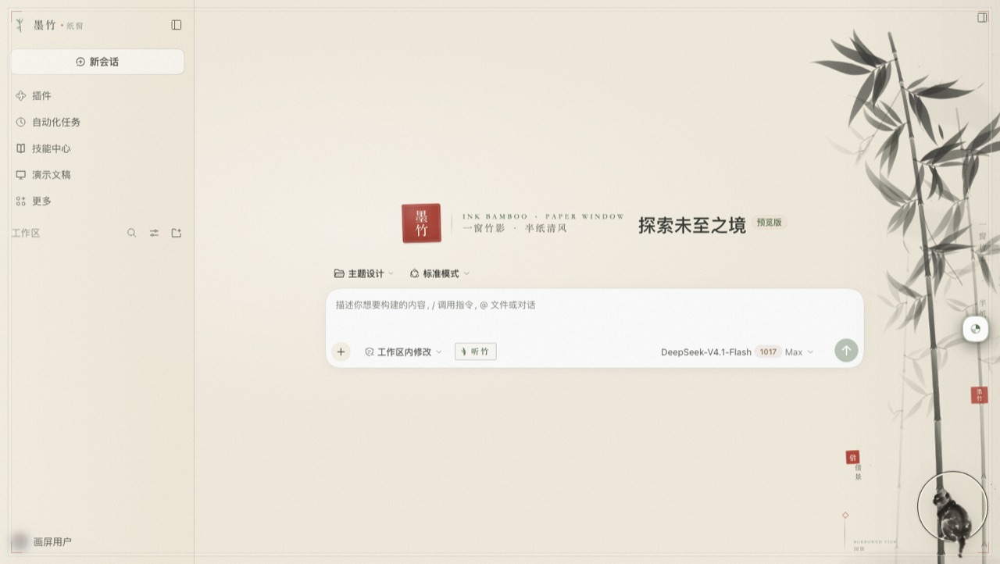 | 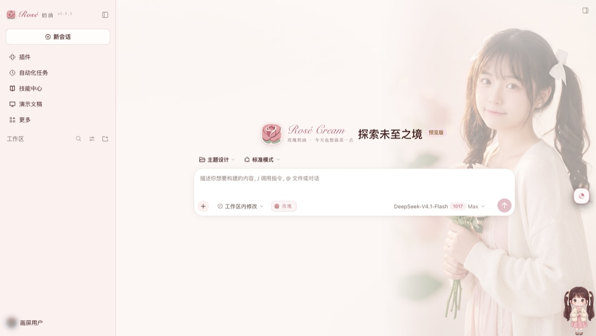 |

<details>
<summary>展开更多</summary>

| 曜界 | 青冥 · 剑冢 | 黑金回廊 |
|---|---|---|
| 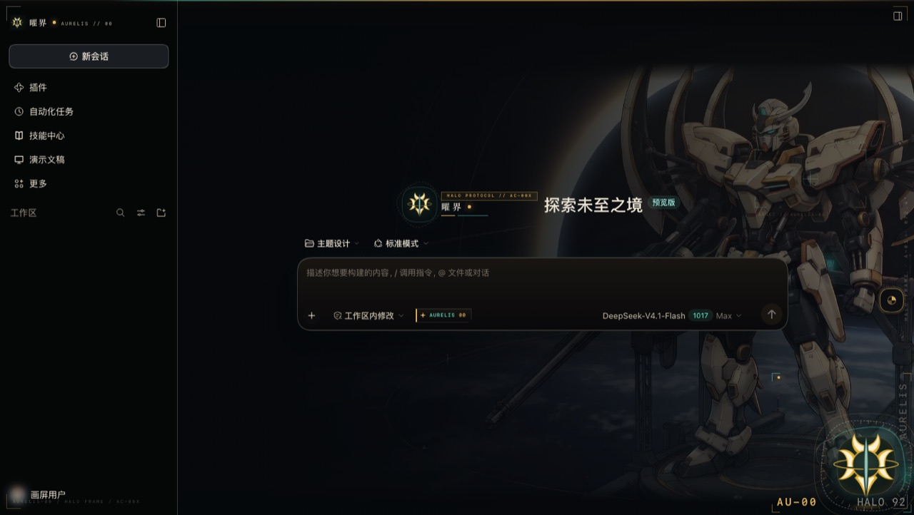 | 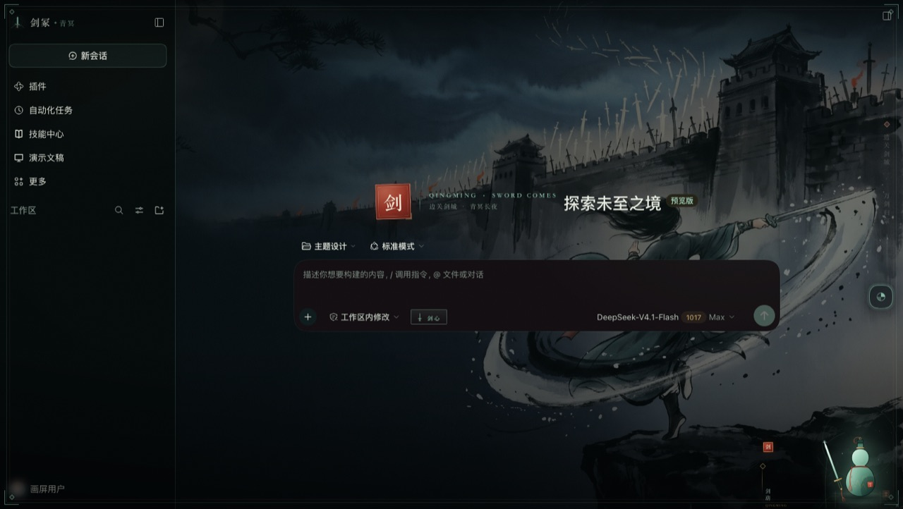 | 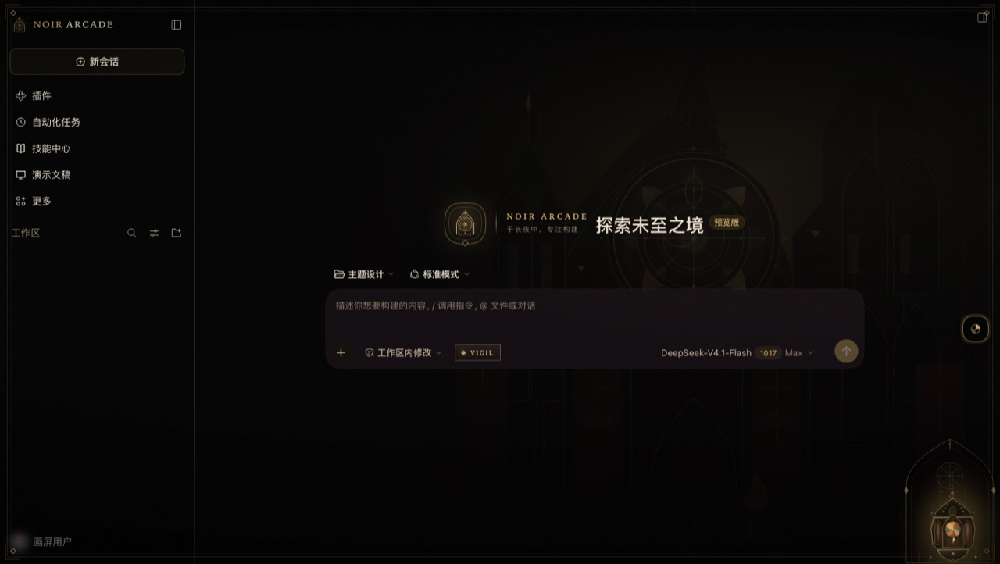 |

| 绯夜尤物 | 大肥鱼 | 零点以后 |
|---|---|---|
| 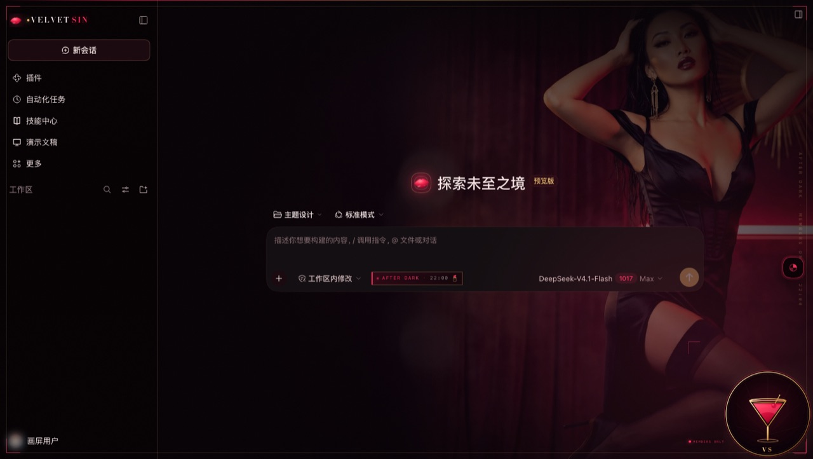 | 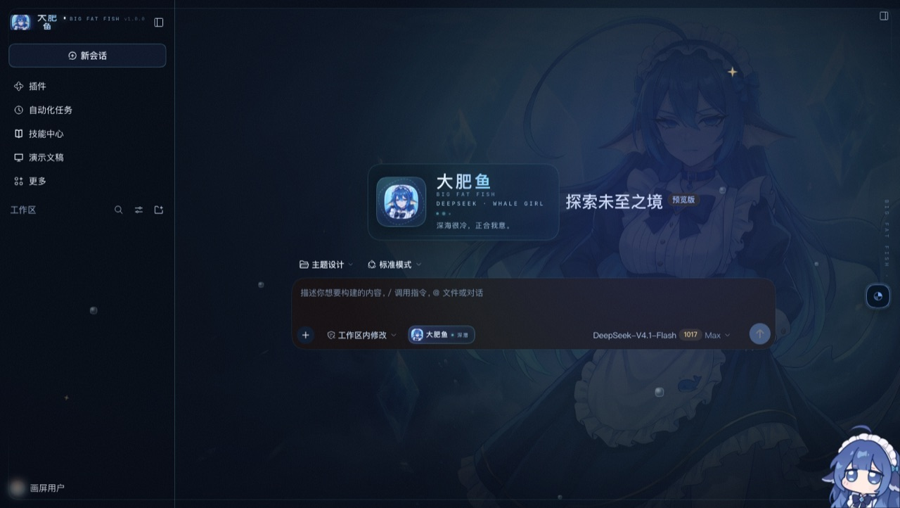 | 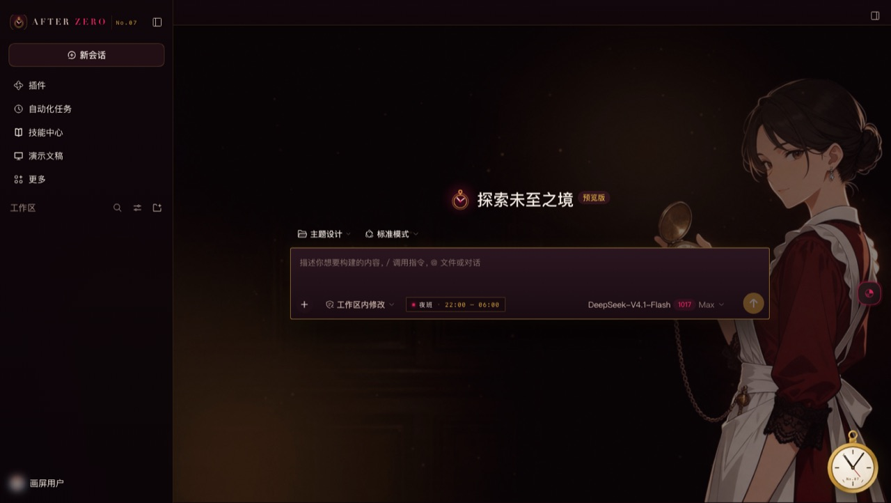 |

| 午后三时 | 春野 | 一比特 |
|---|---|---|
| 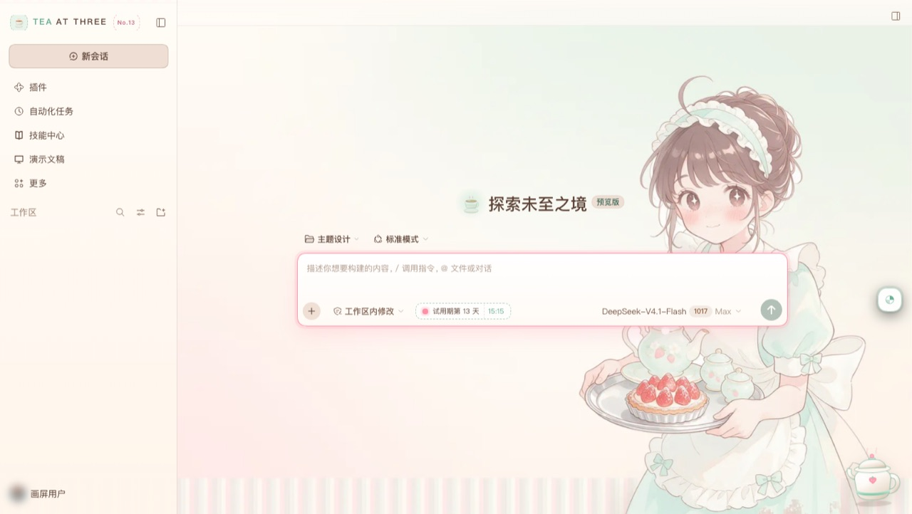 | 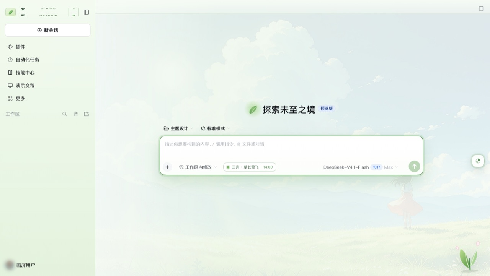 | 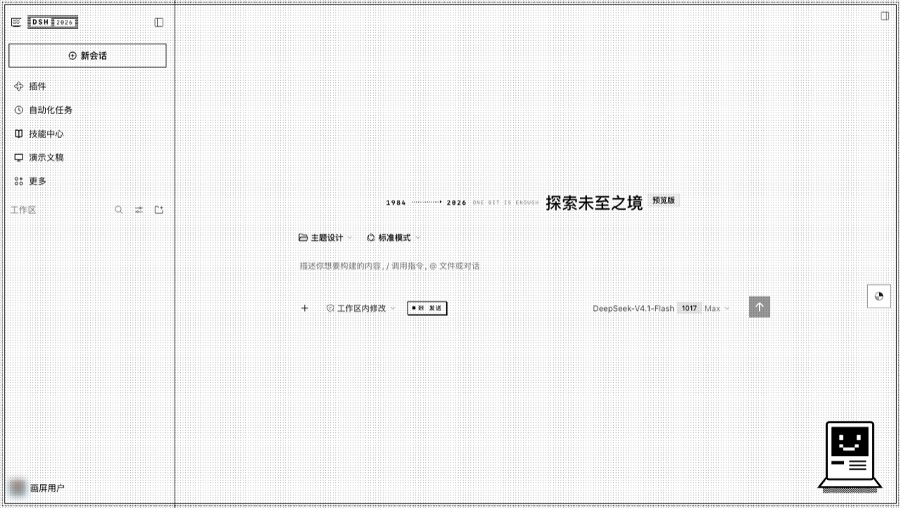 |

</details>

> 全部是新会话页面的实拍，没有后期处理。

### 启动动画

每套皮肤有自己的开场，不是一张静态遮罩。

| 绯夜尤物 | 大肥鱼 | 墨竹 |
|---|---|---|
| 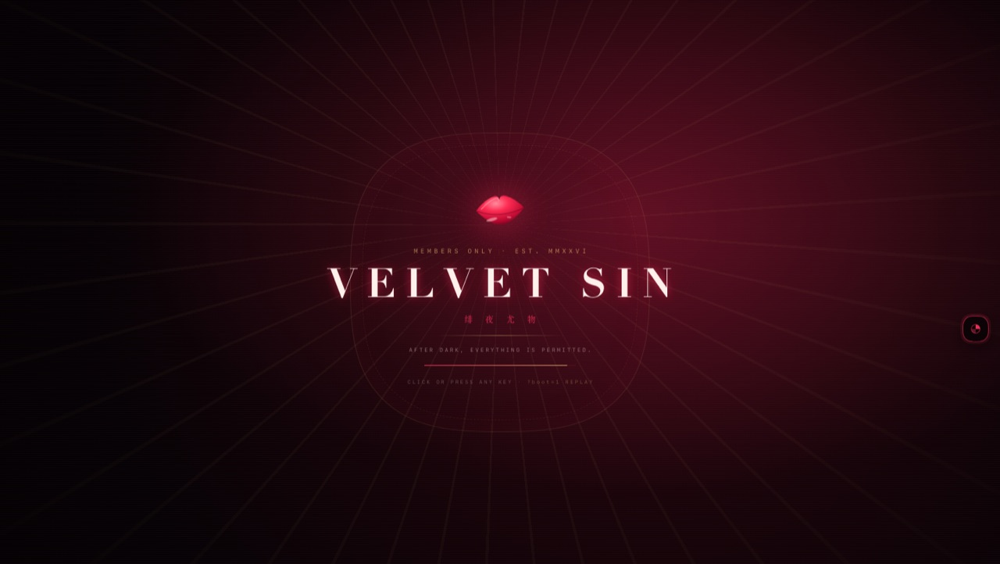 | 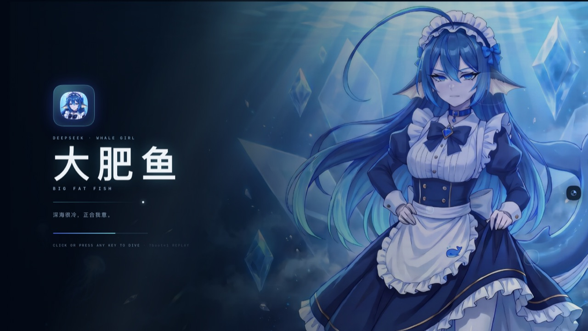 |  |

想关掉开场：URL 加 `?boot=0`。


## 再加一套皮肤

导入的方式：在 vm 里跑原主题拿到求值 CSS 和 110 个 token pair，再按**只认工厂层（4 空格缩进）**的规则切出 slot 组件和依赖闭包，生成 `art/skins/<id>/`。

除了 slot 组件，主题还可能有**副作用安装器**（`sidecars`）——比如墨竹的 `installLiveBamboo` 把动画竹影挂到 `<body>`、绯夜尤物的鲸鱼皮肤。导入时一并带出来，激活皮肤时按顺序执行、切走时执行它们的清理函数。

```bash
node tools/import-one.mjs rose-cream   # 单主题导入
```

每套皮肤都带自己的启动幕、右下角挂件皮肤和皮肤库封面。

> **IP 状态**
> - **EVA-02**：保留同人形态。权利方有公开的同人创作指引（非商用、不得使人误认为官方、官方素材只作引用），本项目免费分享、不接赞助，符合其精神；README 不写「官方标识」，仓库图标与仓库名也不使用其商标。

## 架构

```
apply(ctx)
├── activate(skin)                 ← 切换时先 dispose 旧的，再装新的
│   ├── ctx.theme.overrideTokens()  110 个 token，light/dark 同值
│   ├── <style>                     该皮肤的 CSS，切换即换
│   └── data-hp-skin="…"            根属性，便于 CSS 作用域
├── skinStore.subscribe(activate)  ← 切换的唯一入口
└── 6 个 slot 注册（常驻，不随切换重建）
    ├── shell.overlay ×2           皮肤 overlay + 切换器
    ├── sidebar.brand.mark / .name
    ├── conversation.hero.brand.mark
    ├── conversation.input.left
    └── conversation.composer.dock
```

关键点：**slot 只注册一次**。每个 slot 是一个「宿主组件」，它从 store 读当前皮肤，渲染对应组件，切肤时把 `key` 换掉从而重挂载。这样避免了反复注册 slot 带来的泄漏和顺序问题。

---

## 怎么切换皮肤

插件启用后，界面右缘中部会出现一个圆形按钮（画屏的分色圆标）：

1. 点它 → 打开**整页皮肤库**：顶部有搜索框与标签筛选（复古 / 单色 / 国风 / 机甲 / 哥特 / 装饰艺术 / 赛博 / 柔粉 / 深色 / 浅色 / 同人 / 原创 / 壁纸 / 动画），卡片按题材分组排序并各自带标签；每张封面是**同一构图规则**的真机启动幕截图（16:9、满幅、720×405），一眼能看出该主题的标题样式与主视觉；搜索框与标签栏**固定不滚动**，卡片每页 6 张、滚到底自动续页（也可点「加载更多」），封面图 `loading="lazy"`；每张卡片显示**该主题的启动幕**（不是截图，是同一套组件实时渲染的静态帧），下面是名字、拉丁名和一句话描述，当前皮肤标「● 已应用」；按钮可以**按住拖动**到任意位置（指针捕获，移出按钮后仍跟手），位置记在 `localStorage['huaping-anchor']`；按钮与面板的颜色**跟随当前皮肤**——取该皮肤的 `brand-primary` / `label-primary` / 底色，通过 `--hp-accent` / `--hp-ink` / `--hp-surface` 注入；
2. 点任意一张 → **立即生效**，不用刷新、不用重启，面板保持打开，可以直接来回对比；
3. `Esc`、点遮罩、或右上角 `×` 关闭。

选择存在 `localStorage['painted-screens:skin']`，刷新和重启后保持。

> 为什么不是「设置里的一个下拉」：DSH 的设置导航是 `settings.section` 账本，插件确实可以往那里注册页面，但那是二阶入口——用户要先开设置、再找分区。换皮肤是**高频、看效果**的动作，应该在画面上直接可及。设置入口作为补充入口有价值，见下方路线图。


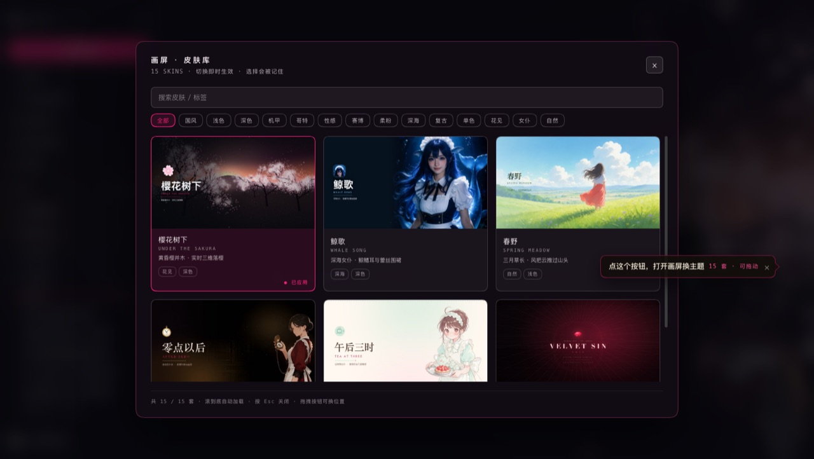


## 目录

```
huaping/
├── client.js                ← 构建产物（DSH 实际加载这个）
├── src/client.template.js   ← 可读源码，改这个
├── art/
│   ├── palettes.json        每套皮肤一份 110 键调色板
│   ├── token-map.json       --dsw-alias-* ↔ 调色板键
│   ├── source/              出图原图（whale-song-visual.jpg 1664×2496）
│   └── （主题资源由 import-one 生成到 art/skins/）
├── skins/<id>/skin.json     皮肤元数据
├── tools/
│   ├── build.mjs            注入调色板/token 表/画作 → client.js
│   ├── make-visual.py       原图 → 羽化 webp（鲸歌壁纸）
│   └── verify-runtime.mjs   无头运行时验证
├── index.js / cordis.patch.yml / locale/ / icon.svg
└── LICENSE
```

### 构建

```bash
node tools/build.mjs          # src/client.template.js + art/ → client.js
node tools/build.mjs --check  # CI: client.js 是否落后于源码
node tools/verify-runtime.mjs # 运行时契约验证
```

`verify-runtime.mjs` 会用桩宿主 + 40 行 React shim 真的跑一遍：冷启动 → 点开切换器 → 切换皮肤 → 卸载 → 重载恢复 → 未知皮肤回退。断言包括 token 数、样式替换、旧层是否被 dispose、根属性、持久化。

皮肤目录里的 `extra.css`（如果有）会拼在 `skin.css` 后面一起内联进 `client.js`——用来整段推翻背景或面板，不必把实验值写回主样式。它是「后手」，靠顺序和 `!important` 生效。

---

## 加一套皮肤

1. 在 `art/palettes.json` 里加一份 110 键调色板（照任意一套抄结构）；
2. 在 `skins/<id>/skin.json` 写元数据；
3. 在 `src/client.template.js` 里加一个对象：

```js
{
  id: 'my-skin',
  name: '我的皮肤',
  latin: 'MY SKIN',
  blurb: '一句话',
  appearance: 'dark',
  palette: 'my-skin',
  swatch: ['#000', '#111', '#222', '#333'],
  css: MY_CSS,
  Overlay, SidebarMark, BrandName, HeroMark, InputLeft, ComposerDock,
}
```

4. `node tools/build.mjs && node tools/verify-runtime.mjs`。

不用改运行时，不用碰 slot 注册。

---

## 路线图

- **设置页入口**：`settings.section` 是设置导航的账本，插件可以注册自己的分区页面；`settings.general.item` 可以在「通用」里加一行。做法已摸清（`ctx.slots.register({ name, id, order }, Component)`），等有空验证 `settings.section` 的选项契约后补一个「外观 · 画屏」分区，作为皮肤库的第二个入口。
- **更多皮肤**：`tools/import-one.mjs` 加一条配置即可接入新主题（色板、CSS、slot 组件、启动幕、挂件皮肤一起导入）。

## 一些取舍

| 项 | 现状 | 备选 |
|---|---|---|
| 包体积 | 全部皮肤内联进一个 `client.js` | 目前约 9 MB；再大就按皮肤拆包、按需加载 |
| 切换器位置 | 固定右缘中部（`right/top: 56%`） | 拖到别处后位置会记住；要恢复默认清 `localStorage` 里的坐标 |
| 挂件皮肤 | 已接入 | 右下角助手挂件跟随当前皮肤换装（配色、头像、气泡） |
| 启动幕 | 已接入 | 每套一套开场，可 `?boot=0` 关闭 |

---

## 版权

代码 MIT。

美术分为两类：原创矢量（纹样、徽记、界面装饰）与图像生成平台产出的人像/场景。前者由作者绘制，后者由作者生成并裁切处理，都不含第三方素材文件。

- 「黑金回廊」的穹顶彩窗为原创 SVG，不指向任何真实建筑。
- 「鲸歌」的鲸鱼纹章是手写 SVG；写真为 AI 生成的原创人像，造型参考自社区「鲸鱼娘」二创，不指向任何真实人物，也不使用 DeepSeek 商标或官方标识。

### 关于 EVA-02

这一套是**非官方同人作品**：

- 与 khara / 福音战士制作委员会没有任何关联，未获授权，也未获背书；
- 不含任何官方素材文件：徽记是作者自绘的六边形 + 字母 Z，人物与场景由图像生成平台产出；
- 不售卖、不接赞助、不做推广，仅作同人交流；
- 权利方如提出要求，会立即移除，详见 [NOTICE](NOTICE.md)。

联系方式：开 issue。

## 托管模式（新一代 API 主题）

托管主题这三套用的是新版主题接口（`ctx.theme.register({ id, colorScheme, tokens })`），
组件按变体注册、没有可切片的独立 CSS。对这类主题，画屏不再切源码，而是**在激活时运行原插件**：

1. 构建时把原 `client.js` 原样嵌入（`meta.hosted: true`，源码存在 `art/skins/<id>/hosted.js`）
2. 激活时用一个 shim ctx 执行它的 `apply()`：`theme.register` 记录变体、`slots.register` 收集组件、`effect` 收集清理函数
3. 插槽宿主优先渲染这些运行时组件（`shell.overlay` 里的 Boot 组件单独给启动幕）
4. 切走时按收集到的清理函数回滚

好处是零改造、和原插件行为一致；代价是这几套的源码会进包体（三套合计约 90KB）。

