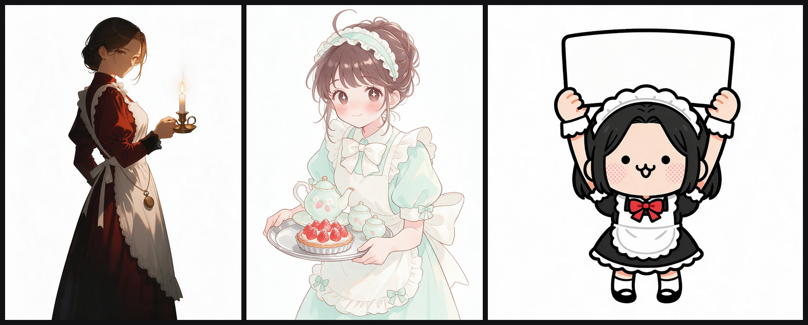

# 女仆三部曲 · 主题规划（文本设计）

> 面向的是每天开着编辑器的人：他们看二次元长大，也分得清「可爱」「做作」和「用力过猛」。
> 所以这三套不追求"女仆"的符号，而是追求三种**班次的人格**。

---

## 0. 一句话

同一间女仆事务所，三个班次，三种人：
**深夜的账房（成人）**、**下午的见习生（少女）**、**值班室的活宝（谐星）**。

三套主题共用一套世界观（班表、工牌、门牌号），但视觉、字体、动效、文案声线完全不同——
这样它们既是三套皮肤，也是一个系列。

---

## 1. 共同设定：MAID AGENCY

- 事务所叫 **「三班」**（拉丁：SHIFT），工牌编号 `No.07 / No.13 / No.00`
- 三班各有一套**班表**：`22:00–06:00`（零点以后）、`15:00–19:00`（午后三时）、`00:00–24:00`（显眼包，永不换班）
- 世界观的复用方式：只在**细节**里出现（门牌号、工牌、班表时间），不做成大段设定文字
- 三套的挂件都是**同一事务所的女仆**，但只有「显眼包」会主动说话吐槽

---

## 2. 三套主题

### 2.1 零点以后 · AFTER ZERO
**班次 22:00–06:00 · 工牌 No.07 · 成人**

**一句话**：零点以后，灯还亮着。

**概念**
酒红丝绒、黄铜怀表、一本摊开的账本。值夜的女仆长不催你睡觉，只是把灯留着。

**情绪关键词**：深夜 / 克制 / 微醺 / 得体。
**明确不做**：不做擦边；气场来自"她比你更稳"，而不是露。

| 角色 | 色值 | 用途 |
|---|---|---|
| 夜底 | `#12070C` | 页面底色 |
| 酒红 | `#4A0F1E` | 面板 / 卡片 |
| 口红 | `#E0245E` | 强调、选中、按钮 |
| 黄铜 | `#D9A441` | 线条、编号、分隔 |
| 象牙 | `#F3E7DC` | 正文、主标题 |
| 梅子 | `#7A2440` | 次级面、hover |

**字体**：标题 `Didot` / `Bodoni 72` 全大写 + `letter-spacing .18em`；中文副标 `Songti SC` 600；正文 `PingFang SC` 300（细字重是"克制"的关键）。

**图形语言**
- 1px 黄铜细线框（不是圆角卡片，是"信笺"）
- 门牌 / 工牌编号：`No.07`，小字号、大字距
- 怀表刻度：细密放射线，用作 loading 与分隔
- 丝绒：深酒红径向渐变 + 极细噪点（opacity 0.06）

**动效**
- 烛焰：`2.8s` 极缓的明暗呼吸（透明度 ±0.06）
- 金线：hover 时 1px 高光从左扫到右，`900ms`
- 换肤时：整屏从暗到亮 `600ms`，像"开了一盏灯"

**挂件（IP 形象）**
- 成年女性，站姿，侧身回望；深色长女仆裙 + 白色围裙 + 袖口蕾丝
- 手托黄铜托盘，盘上一支点燃的烛台
- 光影：单侧暖光（烛光），面部半明半暗
- **气泡**：酒红丝绒卡片，四角 2px 圆角、金色发丝内框；右下角一枚黄铜圆形印章 `No.07`；文字用宋体，金额用 Didot 斜体

**文案声线**（沉稳、敬语、偶尔揶揄）
> 「今晚的账，我替您记着。」
> 「已经过了零点。咖啡因和代码，都少喝一点。」
> 「灯给您留着。要关的时候说一声。」

**封面构图**：左 1/3 竖排标题（宋体）+ 门牌；右侧是她在烛光里的半身，背景压到近黑。整体 16:9，底部留一条黄铜细线。

**标签**：`女仆` `深色`

**与现有主题的区分**
- vs **绯夜尤物**：绯夜是"舞台 + 霓虹 + 装饰艺术"，零点以后是"室内 + 烛光 + 信笺"；一个向外张扬，一个向内收敛。

---

### 2.2 午后三时 · TEA TIME
**班次 15:00–19:00 · 工牌 No.13 · 少女**

**一句话**：试用期第 13 天，茶点还没洒。

**概念**
薄荷奶油色的见习女仆，把下午午后三时的茶点端到你桌上。她努力、笨拙、认真得有点好笑。

**情绪关键词**：明亮 / 柔软 / 努力 / 无害。
**明确不做**：不卖萌过度；她是"笨手笨脚的新人"，不是"撒娇的宠物"。

| 角色 | 色值 | 用途 |
|---|---|---|
| 奶油 | `#FFF8F0` | 页面底色 |
| 薄荷 | `#BFE3D0` | 主面 / 选中 |
| 草莓 | `#FF8FA6` | 强调、按钮 |
| 可可 | `#6B4A3A` | 正文（不用纯黑） |
| 抹茶 | `#8FBF9F` | 次级线 / 图标 |

**字体**：拉丁 `Futura Book`；中文 `PingFang SC` Regular，字距比默认宽 `0.02em`；数字用等宽（tabular），因为要显示 token 数。

**图形语言**
- 药丸形（`border-radius: 999px`）——按钮、标签、输入框都是胶囊
- 虚线贴纸边（`1.5px dashed`）+ 白描边，像手帐贴纸
- 蝴蝶结、茶渍圆环（`radial-gradient` 做的那圈淡淡的水痕）
- 20px 苏格兰格纹桌布（只在侧栏和输入框边缘出现，不要铺满）

**动效**
- 蝴蝶结：`6s` 轻摆 `rotate ±2deg`（只动装饰元素，不动文字）
- 小圆点：入场时向上飘 `12px` 后落定
- 发送消息时：输入框"托盘轻晃" `translateY 2px`，`180ms`

**挂件（IP 形象）**
- 少女见习女仆，半身，双手捧托盘；托盘上：一只茶壶、一块草莓塔
- 线条软、腮红明显、发型是「努力扎起来但还是翘一撮」
- **气泡**：便签纸质感（横线 + 打孔），顶部两枚"胶带"贴住，右上角一个手绘爱心；金额用圆体、加一点手写倾斜

**文案声线**（元气 + 敬语 + 偶尔结巴）
> 「欢、欢迎回来！今天的茶点是草莓塔——我、我没有偷吃！」
> 「午后三时啦，要不要先休息一下？」
> 「这个报错……我查了三遍，还是没看懂（小声）」

**封面构图**：左上标题 + 一枚"班表"小卡；右侧她半身 + 托盘；背景是奶油底 + 大面积留白 + 几片薄荷叶。

**标签**：`女仆` `浅色`

**与现有主题的区分**
- vs **玫瑰奶油**：玫瑰是"真实摄影 / 成人柔粉"，午后三时是"手绘卡通 / 少女"；同样是粉，一个是照片，一个是插画。
- 现有 12 套里没有"手绘卡通"这个位，正好补上。

---

### 2.3 显眼包 · SCENE STEALER
**班次 00:00–24:00（永不换班） · 工牌 No.00 · 谐星**

**一句话**：头比身子大，活比谁都多。

**概念**
一个头占身体两倍的女仆，专治加班。她什么都知道，但什么都帮不上忙。

**情绪关键词**：沙雕 / 吵闹 / 自嘲 / 梗多。
**明确不做**：不做低俗段子；笑点来自"她太认真地在胡说八道"。

| 角色 | 色值 | 用途 |
|---|---|---|
| 亮黄 | `#FFD400` | 主面 / 警告条 |
| 番茄 | `#FF3B2F` | 强调、按钮、错位描边 |
| 墨黑 | `#111111` | 描边、正文 |
| 纸白 | `#FFFDF7` | 底色 |
| 荧光青 | `#00E5C0` | 极小面积点缀（对撞色） |

**字体**：拉丁 `Arial Black` / `Impact`；中文 `PingFang SC Heavy`；字号巨大、行距压到 `1.05`；允许 `-2deg` 倾斜。

**图形语言**
- 4px 粗黑描边，所有容器都是"贴纸"
- 网点（halftone）：`background-image: radial-gradient(#111 1px, transparent 1px)`，8px 网格
- 速度线 / 爆炸星（漫画拟声）
- **错位印刷**：文字用红、青两层 `text-shadow` 各偏移 2px，模拟套印不准
- 对话框尾是锯齿，不是圆角

**动效**
- 气泡弹出：`cubic-bezier(.34,1.56,.64,1)` 过冲，`260ms`
- 头像：`3s` 上下弹 `translateY ±3px`
- hover：整块 `rotate(-1.5deg)` 抖一下
- 偶尔（10% 概率）在角落冒一张「！」贴纸，2s 后自己消失

**挂件（IP 形象）**
- 显眼包：头身比约 `2:1`，豆豆眼 + 猫嘴（`ω`），小身体举着一块牌子
- 牌子内容随机：「正在摸鱼」「这不是 bug」「喝口水吧」
- **气泡**：漫画对话框（白底 + 4px 黑边 + 锯齿尾 + 网点阴影），文字可倾斜 `-2deg`；金额用 Arial Black，配一个「¥」大符号

**文案声线**（玩梗、夸张、自称"本女仆"）
> 「主人！您的代码又双叒叕编译失败了——（骗你的）」
> 「本女仆查过了：这不是 bug，是 feature 的远房亲戚。」
> 「今日消耗 ¥0.40。够买一根冰棍，不够买您掉的那根头发。」

**封面构图**：满版亮黄 + 巨大标题压在左侧（可出血）+ 她的大头从右侧探出来，"工牌"挂歪了；底部一条警告胶带（黑白斜纹）。

**标签**：`女仆` `搞笑`

**与现有主题的区分**
- vs **EVA-02**：那个是"燃"，这个是"闹"。现有 12 套里没有任何喜剧向主题。

---

## 3. 三套对照表

| | 零点以后 | 午后三时 | 显眼包 |
|---|---|---|---|
| 人格 | 成年 · 稳 | 少女 · 努力 | 谐星 · 闹 |
| 底色 | `#12070C` 近黑酒红 | `#FFF8F0` 奶油 | `#FFFDF7` 纸白 + 亮黄满版 |
| 强调 | `#E0245E` 口红 | `#FF8FA6` 草莓 | `#FF3B2F` 番茄 |
| 字体 | Didot + 宋体 | Futura + 苹方 | Arial Black + 苹方 Heavy |
| 形状 | 直角信笺 + 1px 金线 | 胶囊 + 虚线贴纸 | 粗描边贴纸 + 网点 |
| 动效 | 烛焰呼吸 | 蝴蝶结轻摆 | 过冲弹跳 |
| 气泡 | 丝绒卡 + 黄铜印章 | 便签 + 胶带 | 漫画对话框 + 锯齿 |
| 标签 | 女仆 / 深色 | 女仆 / 浅色 | 女仆 / 搞笑 |

---

## 4. IP 形象参考

> 原则：**只借造型语言，不借角色**。所有形象原创，生成提示词里不写"某某角色"。

### 4.1 成人 · 零点以后

| 参考 | 来源 | 借什么 | 不借什么 |
|---|---|---|---|
| 《黑礁》Roberta | [ANN 影评](https://www.animenewsnetwork.com/review/black-lagoon/roberta-blood-trail/bd+dvd) / [手办页](https://www.sideshow.com/collectibles/black-lagoon-roberta-the-maid-of-nightmares-medicos-entertaiment-914052) | 「女仆装 + 危险气场」的反差；黑色长裙的剪裁 | 军火、暴力题材 |
| 《OVERLORD》昴宿星团 | [Shizu Delta 手办](https://www.toy-people.com/en/?p=93390) / [Entoma 手办](https://www.toy-people.com/en/?p=93229) | 团队制服、金属配件、异色点缀 | 奇幻种族设定 |
| 《会长是女仆大人》鲇沢美咲 | [角色页](https://aminoapps.com/c/anime/page/item/misaki-ayuzawa/JJtM_Ir1o0xoVpwMVL03kVQlMpqgREim) | 「白天/夜晚双面」的叙事结构 | 校园设定、制服 |

**造型结论**：黑色长裙 + 白围裙 + 袖口蕾丝 + **一件黄铜配饰**（怀表或烛台），面部只给一侧光。气质靠"站姿 + 光"解决，不靠露。

### 4.2 少女 · 午后三时

| 参考 | 来源 | 借什么 | 不借什么 |
|---|---|---|---|
| 《请问您今天要来点兔子吗？》 | [作品页](https://watch.plex.tv/pt/show/is-the-order-a-rabbit/credits) | 咖啡店制服的圆润线条、暖光、留白 | 具体角色与配色 |
| 日本「ゆるキャラ」方法论 | [Web Japan](https://web-japan.org/trends/11_culture/pop202503_local-characters.html) | 「一眼记住轮廓」的造型原则 | 吉祥物的布偶质感 |

**造型结论**：半身、托盘、茶点；线条软、腮红重、头发"扎起来翘一撮"。用**低对比暖色**，避免和玫瑰奶油撞"写真感"。

### 4.3 谐星 · 显眼包

| 参考 | 来源 | 借什么 | 不借什么 |
|---|---|---|---|
| 《Pop Team Epic》 | [ANN](https://www.animenewsnetwork.com/interest/2018-02-13/the-action-continues-in-pop-team-epic-home-video-art/.127742) / [pixivision](https://www.pixivision.net/th/a/3150) | 极端大头比例、粗描边、拼贴感 | 角色本身、具体梗图 |
| SD / デフォルメ 传统 | [ANN 词条](https://m.animenewsnetwork.com/encyclopedia/lexicon.php?id=44) | 2–3 头身、五官极度简化 | —— |

**造型结论**：头身比 `2:1`，豆豆眼 + `ω` 嘴，4px 描边；情绪靠**极端比例**而不是表情细节。

---

## 5. 原创边界与生成策略

- **边界**：成人向只做"成熟 + 得体"，不做露骨；少女向不做任何性化处理（她是"笨拙的新人"，笑点在工作，不在身体）；谐星向不做低俗段子。
- **生成**：每套形象用描述性提示词（服装、光、姿态、媒介），**不提任何已有角色名**；按 `docs/IMAGE-GEN-POLICY.md` 执行（同一提示词最多 2 次），产出登记进 `NOTICE.md`。
- **提示词骨架**（后续再细化）：
  - 零点以后：`adult woman, long dark maid dress, white apron, brass candlestick, single candle light from left, deep wine background, cinematic, soft rim light, anime illustration, no text`
  - 午后三时：`young apprentice maid, mint and cream uniform, holding a tray with teapot and strawberry tart, soft pastel, warm daylight, hand-painted anime illustration, white background`
  - 大头：`chibi maid, oversized head 2:1, dot eyes, cat mouth, thick black outline, flat colors, comic sticker style, white background`

---

## 5.5 角色概念稿（首轮）

三张都是描述性提示词直出、纯白底，后续再抠底裁切。

| | 文件 | 这一版的样子 | 下一版要修 |
|---|---|---|---|
| 零点以后 | [`art/skins/after-zero/assets/art.jpg`](art/skins/after-zero/assets/art.jpg) | 酒红长裙 + 白围裙 + 袖口蕾丝，侧身持怀表，顶光切一半脸 | 裙型偏维多利亚，要更像"女仆长"：加小帽与胸针，裙长收到小腿 |
| 午后三时 | [`art/gen/maid-teatime.jpg`](art/gen/maid-teatime.jpg) | 薄荷奶油制服、托盘 + 茶壶 + 草莓塔、翘起的一撮头发、腮红 | 手部比例略大；托盘要更小一点，给挂件留白 |
| 显眼包 | [`art/gen/maid-bighead.jpg`](art/gen/maid-bighead.jpg) | 2:1 头身、豆豆眼 + `ω` 嘴、粗黑描边、红蝴蝶结、举着空白牌子 | 牌子太大（占了画面上半），要缩到头的 1.4 倍宽 |

三轮之内不能再改形象的话也没有关系：**这三张已经足够支撑第一版皮肤**，后面按需再迭代。

## 6. 落地顺序（建议）

1. **显眼包**——最容易出效果，传播性最强，先用它验证"女仆"这条线在开发者里是否吃得开
2. **午后三时**——补"手绘卡通"这个空位，工作量中等
3. **零点以后**——图最难（光与材质），放最后，等前两套的挂件流程跑顺

每套的产出清单与现有 12 套一致：`meta.json` / `skin.css` / `token-pairs.json` / `components.js` / `widget.js` / 封面 / 启动幕 / README 段落。

---

## 7. 已定

1. **名字**（网感向）：`零点以后` / `午后三时` / `显眼包`
2. **尺度**：成人向停在"成熟气场"，靠站姿与单侧烛光，不靠露；少女向不做性化处理。
3. **世界观**：共用「三班事务所」——班表、工牌 `No.07 / No.13 / No.00`、门牌，只在细节里出现。

**命名理由**

| 名字 | 为什么这么叫 |
|---|---|
| 零点以后 | 互联网上"零点以后的我"是个固定情绪；四个字自带时间感，又不直说"女仆"，留白给画面 |
| 午后三时 | 下午茶的老梗，但读起来是个具体时刻；配"试用期"人设，反差正好 |
| 显眼包 | 现成的网络俗语，指的是"在一群人里最跳的那个"——大头形象一眼就成立，不用解释 |

**三句 tagline**（后续用在封面副标与 README）

- 零点以后：`零点以后，灯还亮着。`
- 午后三时：`试用期第 13 天，茶点还没洒。`
- 显眼包：`头比身子大，活比谁都多。`
